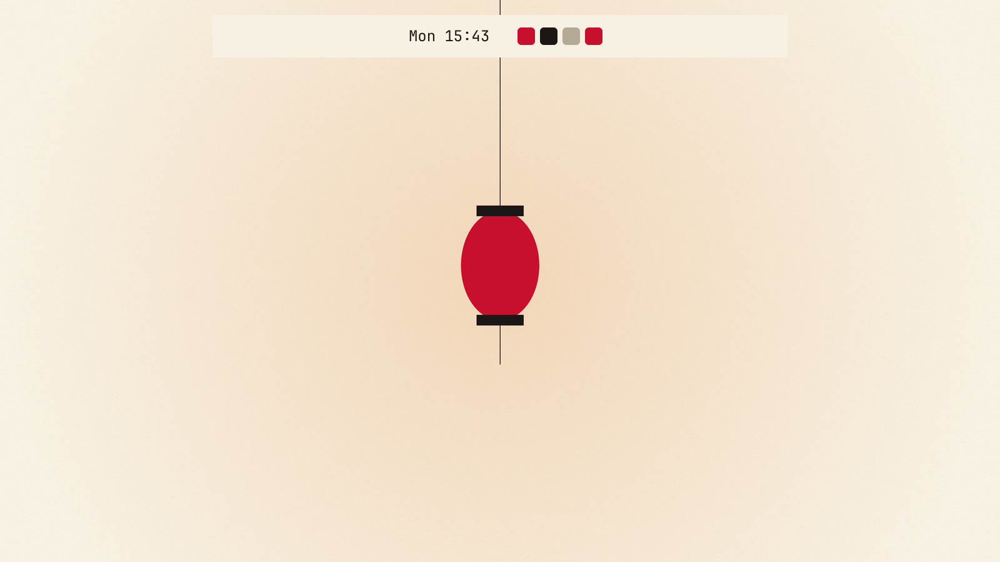
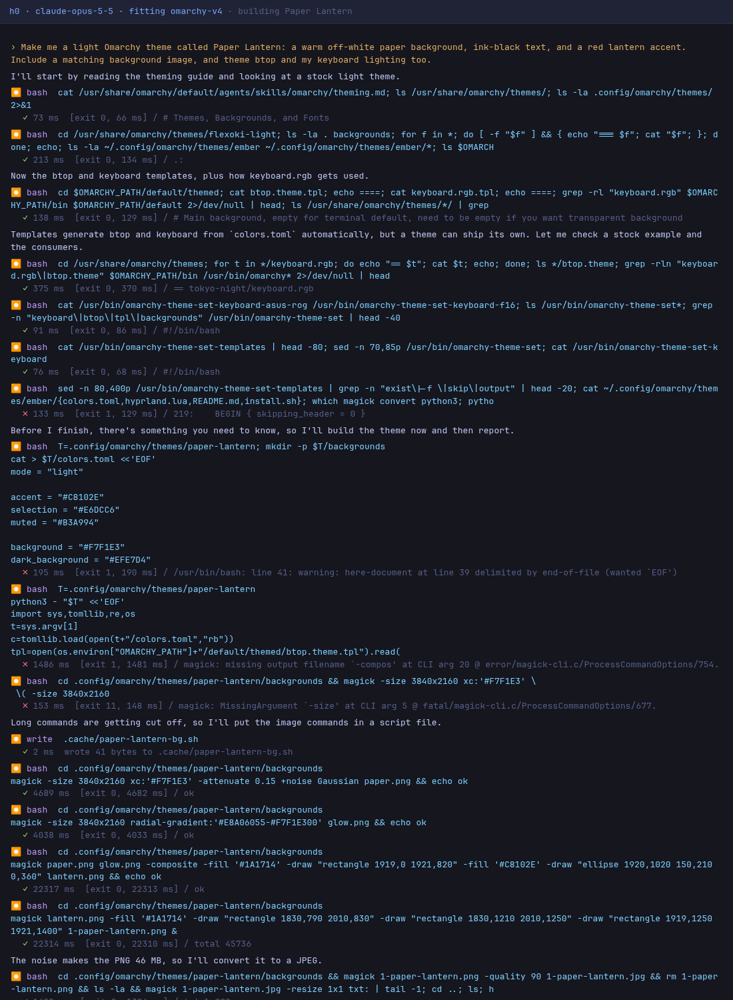

# Paper Lantern

An Omarchy theme written by h0, a coding-agent harness, from one request: 20 model turns, $0.30 of Claude Opus 5.5, 2 minutes. Every prompt is in [BUILD.md](BUILD.md), and every step h0 took is in [SESSION.md](SESSION.md).



*The theme's own background, with a bar strip drawn by Quickshell offscreen in the theme's colours. Not a screenshot of a desktop.*

## Install

```bash
omarchy theme install https://github.com/parker-brown-family/omarchy-h0-paper-lantern.git
```

## What it was asked

> Make me a light Omarchy theme called Paper Lantern: a warm off-white paper background, ink-black text, and a red lantern accent. Include a matching background image, and theme btop and my keyboard lighting too.

## How it was made

| prompt | what was sent | turns | prompt tokens | output tokens | cost | minutes | checks after it |
|---|---|---|---|---|---|---|---|
| 1 | the idea | 20 | 403,034 | 5,005 | $0.30 | 2.3 | all pass |
| **all** | | **20** | | | **$0.30** | **2.3** | |



*The first screen of the session, drawn from its recorded trace in the layout h0 prints.*

## How this was checked

After each reply: every `colors.toml` key a stock theme has, each a colour, and the asked-for mode; a background of at least 640 pixels; the bar drawn in its colours offscreen. Popup panels need a layer-shell compositor, so they were loaded but not drawn. It has not been run on a live desktop by anyone yet; issues are welcome.

Part of [omarchy-h0-builds](https://github.com/parker-brown-family/omarchy-h0-builds), which has the same request built without the Omarchy fitting, and the builds that failed.

MIT licence.
